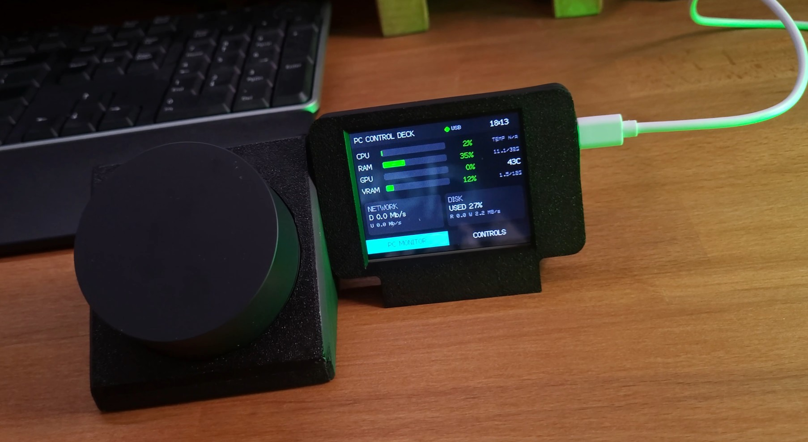
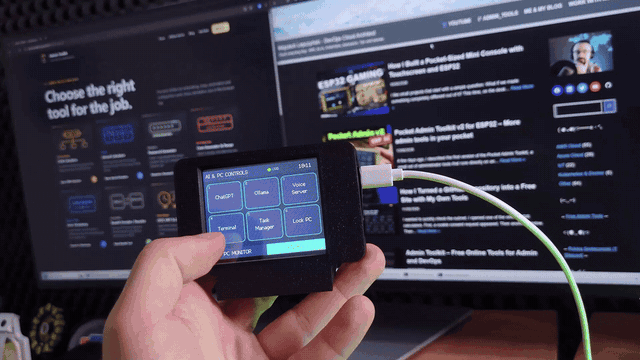

# ESP32 PC Control Deck

An open-source desktop companion built around the **Elecrow 2.8-inch ESP32 Solo Miner LCD Display**. The touchscreen shows live PC stats and offers six customizable shortcuts. A single USB cable carries both power and serial data.

**[Website and browser installer](https://esp32-pc-control-deck.lepczynski.it/)** | **[Full YouTube walkthrough](https://www.youtube.com/watch?v=16eqHU4j9Fk)**

[](https://esp32-pc-control-deck.lepczynski.it/)

### What it does

The monitor screen displays CPU, RAM, GPU, VRAM, network transfer, disk statistics, clock and temperatures where sensors are available. Touch shortcuts can open ChatGPT, local Ollama, a voice server, Task Manager, a terminal or lock the PC. The actual commands and labels are configured on the computer, not hardcoded into firmware.



The device is a **classic ESP32-WROOM-32 with CH340 USB-to-UART**, not a native USB HID keyboard. Its touch actions are sent over USB to a trusted **Python PC bridge**. The bridge is required for telemetry and macros. You can run the software on Windows, macOS or Linux, with OS-specific limitations.

## Install from the website

**No local PlatformIO setup is needed to install the published ESP32 firmware.**

1. Open **https://esp32-pc-control-deck.lepczynski.it/** in desktop Chrome or Edge over HTTPS.
2. Connect the supported Elecrow 2.8-inch ESP32 touchscreen with a USB **data** cable.
3. Stop any serial monitors and running PC bridge so the CH340 port is free.
4. Click **Install latest firmware**, select the serial port and follow the prompts.
5. Download the **PC bridge** from the same page, extract the ZIP and start it on your computer. Firmware alone cannot read your PC metrics or launch programs.

**Hardware:** ESP32-WROOM-32-N4, 4 MB flash, ILI9341V 320×240 TFT, XPT2046 resistive touchscreen and CH340 serial bridge. Do not flash this build to a different board without confirming pins, screen and flash layout.

## PC bridge: required

Install **Python 3** on the computer. The bridge runs locally and communicates over USB serial. It does not require Wi-Fi, a cloud backend or device API keys.

- **Windows:** Extract the [PC bridge download](https://esp32-pc-control-deck.lepczynski.it/downloads/PC-Control-Deck-PC-Bridge.zip), then run `host\run_windows.bat`. First run creates a Python virtual environment, installs dependencies and copies the example configuration.
- **macOS / Linux:** From the extracted package, run `sh host/run_linux_macos.sh`. Use `sh host/run_linux_macos.sh --list-ports` to list serial ports.
- **Custom actions:** Edit your local `host/config.json`, created from `host/config.example.json`, to choose commands and serial port. Never commit this file with private local paths or secrets.
- **Optional Windows temperatures:** LibreHardwareMonitor can provide local sensor data when its local web server is enabled.

For detailed functionality, see [Hardware](docs/HARDWARE.md), [Protocol](docs/PROTOCOL.md), [Macros](docs/MACROS.md), [Temperatures](docs/TEMPERATURES.md) and [macOS/Linux notes](docs/LINUX_MACOS.md).

## Automatic Cloudflare build, no GitHub Actions

This repository uses **Cloudflare Workers Builds with Static Assets**. When `main` changes, Cloudflare installs build dependencies, compiles firmware with PlatformIO, creates the ESP Web Tools manifest, packages the Python PC bridge and publishes them together with the static website. Only a **successful** build is deployed, so the page and installer reference the same source commit. The built firmware is not stored in the repository.

There are **no GitHub Actions workflows, no `gh-pages` branch requirement, no dedicated application server and no need to build firmware manually** for regular releases.

### Cloudflare dashboard settings

Create or edit a **Worker** connected to GitHub repository `lepczynski-cloud/ESP32-PC-Control-Deck` (not a separate Pages Git project). Use these settings:

| Setting | Value |
| --- | --- |
| Git / production branch | `main` |
| Root directory | Repository root (empty) |
| Build command | `bash scripts/build_pages.sh` |
| Deploy command | `npx wrangler deploy` |
| Output directory | Defined by `wrangler.jsonc` as `./dist` |
| Worker name | `esp32-pc-control-deck` |
| Custom domain | `esp32-pc-control-deck.lepczynski.it` |

**Do not set a separate Pages output directory.** `wrangler.jsonc` already defines the Worker Static Assets directory. Connect the domain under **Workers & Pages → Worker → Settings → Domains & Routes** after a successful deployment. If the hostname is currently attached to an old Pages project, remove that binding before assigning it to the Worker. Avoid conflicting DNS/routes for the same hostname. Node.js and Python use supported Cloudflare build-environment versions rather than pinning a release in the repository.

The production build runs `scripts/build_pages.sh`. This script performs tests, compiles the exact PlatformIO environment, creates a merged image at ESP32 flash offset `0x0`, validates firmware SHA-256 and manifest, and places the site, original device photo, optimized real-device GIF and PC bridge ZIP in `dist/`. ESP Web Tools is bundled into the static output during build. There is no runtime third-party code CDN; the YouTube iframe is loaded only when a visitor plays the video.

**Development build (optional, not required for normal users):**

```bash
pio run -e esp32_pc_control_deck
pio run -t upload -e esp32_pc_control_deck
```

The platform and device libraries in `platformio.ini` are deliberately versioned to avoid unexpected firmware regressions. The website's build environment doesn't require pinning the Node.js or Python runtime versions.

## Related projects

- [Admin Pocket Toolkit on ESP32](https://esp32-admin-toolkit.lepczynski.it/)
- [Online Admin Toolkit](https://admintoolkit.lepczynski.it/)
- [M5Stack Touch Control Deck](https://m5stack-touch-control-deck.lepczynski.it/)
- [CrowPanel Rotary Buddy](https://crowpanel-rotary-buddy.lepczynski.it/)
- [Blog](https://lepczynski.it/) and [YouTube channel](https://www.youtube.com/@WojciechLepczynski)

## License and disclosure

MIT licensed; see [LICENSE](LICENSE) and [SECURITY.md](SECURITY.md). The device was supplied by Elecrow for a review; it was not a paid sponsorship.
